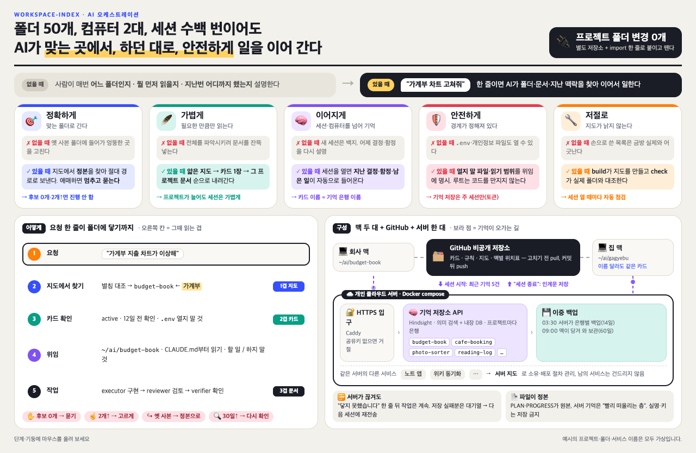

# workspace-index

**폴더가 수십 개여도 AI 코딩 에이전트가 맞는 폴더에서, 하던 대로, 안전하게 일하게 하는 카탈로그 층.**

AI 코딩 도구를 오래 쓰면 작업공간에 프로젝트, 복사본, 옛 클론, 실험 폴더가 쌓입니다. 그러면 에이전트가 "가계부 고쳐줘"를 듣고 옛 클론에 들어가거나, 무엇을 먼저 읽어야 하는지 몰라 헤매거나, 어제 정한 것을 잊어버립니다. workspace-index는 **프로젝트 하나 = 카드 한 장**인 카탈로그와, 그 카탈로그를 읽고 일을 나눠 주는 **오케스트레이터 세션** 규칙으로 이 문제를 풉니다.



> 인터랙티브 버전: [`docs/intro.html`](docs/intro.html) (브라우저로 열기)

## 무엇이 좋은가

| | 없을 때 | 있을 때 |
|---|---|---|
| 🎯 **정확하게** | 옛 사본 폴더에 들어가 엉뚱한 곳을 고친다 | 지도에서 정본을 찾아 절대 경로로 보낸다. 애매하면 멈추고 묻는다 |
| 🪶 **가볍게** | 전체를 파악시키려 문서를 잔뜩 넣는다 | 얇은 지도 → 카드 1장 → 그 프로젝트 문서 순으로만 읽는다 |
| 🧠 **이어지게** | 새 세션은 백지다 | (선택) 세션을 열면 지난 결정·함정·남은 일이 들어온다 |
| 🛡️ **안전하게** | `.env`·개인정보 파일도 열 수 있다 | 열지 말 파일·읽기 범위를 위임에 적는다. 루트 세션은 코드를 만지지 않는다 |
| 🔧 **저절로** | 손으로 쓴 목록은 금방 낡는다 | build가 지도를 만들고 check가 실제 폴더와 대조한다 |

그리고 **프로젝트 폴더는 하나도 바꾸지 않습니다.** 이 저장소를 작업공간 루트에 두고 루트 안내 파일에 import 한 줄을 넣으면 붙고, 지우면 떨어집니다.

## 이런 분께 맞습니다

- 사이드 프로젝트·실험·사본이 수십 개 쌓인 개인 개발자
- 회사 맥과 집 맥처럼 컴퓨터 여러 대에서 같은 프로젝트를 하는 사람
- 작은 자동화 스크립트가 많고 개인정보를 다루는 비개발 직군(HR·총무·재무 등)
- 고객별 폴더가 많은 프리랜서

저장소 하나만 깊게 다루거나 여러 사람이 함께 쓰는 큰 팀이라면 얻는 것이 적습니다.

## 1분 체험

실제 작업공간을 건드리지 않고, 임시 폴더에 가짜 작업공간을 만들어 build·check를 돌려 봅니다.

```bash
git clone <this-repo> workspace-index-kit
bash workspace-index-kit/examples/demo.sh        # KEEP=1 을 붙이면 임시 폴더를 남긴다
```

예시 카드 6장으로 지도를 만들고, 새 폴더가 생겼을 때·지도를 손으로 고쳤을 때 check가 어떻게 잡는지, 집 맥에서 폴더 이름이 달라도 같은 카드가 쓰이는 모습을 보여 줍니다.

## 구조

```
~/ai/                          ← 작업공간 루트 (CLAUDE.md 에 import 한 줄)
├── workspace-index/           ← 이 저장소 (비공개로 운영)
│   ├── ORCHESTRATOR.md        ← 루트 세션의 동작 규칙. 마지막 줄이 @PROJECTS.md
│   ├── PROJECTS.md            ← 지도. build 가 생성
│   ├── config.json            ← 기본 맥 이름, 그룹, 묶음 폴더
│   ├── catalog/<name>.md      ← 카드 (프로젝트마다 한 장)
│   ├── excluded.md            ← 카드 없는 폴더와 사유
│   ├── machines/<맥>.md        ← 다른 컴퓨터의 위치표 (선택)
│   ├── scripts/               ← catalog.py (build·check), session_start.py (시작 훅)
│   └── memory/                ← 기억 저장소 연결 (선택)
├── budget-book/               ← 프로젝트 폴더들 (건드리지 않음)
├── cafe-booking/
└── …
```

세 겹으로 읽습니다.

1. **규칙 + 지도** (`ORCHESTRATOR.md`, `PROJECTS.md`): 루트 세션을 열면 항상 올라온다
2. **카드 한 장** (`catalog/<name>.md`): 보낼 폴더가 정해졌을 때만 연다
3. **프로젝트 문서** (카드의 `entry_docs`): 실제로 일을 시작할 때 읽는다

## 설치

필요한 것: macOS 또는 Linux, Python 3.9 이상, git. [Claude Code](https://docs.claude.com/en/docs/claude-code) 기준으로 설명합니다(다른 도구라면 규칙 문서와 카드 구조만 가져다 쓸 수 있습니다).

1. **작업공간 루트에 넣는다.** 폴더 이름은 `workspace-index`로 둡니다. 카드에 내 프로젝트 목록이 들어가므로 원격은 **비공개** 저장소로 둡니다.
   ```bash
   cd ~/ai
   git clone <this-repo> workspace-index
   cd workspace-index && rm -rf examples && git remote remove origin   # 내 비공개 원격을 따로 붙인다
   ```
2. **`config.json`을 고친다.** `default_machine`을 지금 컴퓨터 이름(작업공간 루트의 부모 폴더 이름, 예: `/Users/alex/ai`면 `alex`)으로, `groups`를 내 분류로 바꿉니다.
3. **카드를 쓴다.** 폴더마다 `ls`·`git log -1`로 확인하고 `catalog/_template.md.txt`를 복사해 채웁니다. 프로젝트가 아닌 폴더는 `excluded.md`에, 옛 클론은 정본 카드의 `covers`에 적습니다. 형식은 [`docs/card-format.md`](docs/card-format.md).
   > 카드 쓰기는 루트에서 연 에이전트에게 맡겨도 됩니다: "workspace-index/docs/card-format.md를 읽고 이 작업공간의 폴더마다 카드를 써 줘. 폴더 내용은 바꾸지 마."
4. **지도를 만들고 점검한다.** 오류가 0이 될 때까지 카드를 고칩니다.
   ```bash
   cd ~/ai
   python3 workspace-index/scripts/catalog.py build
   python3 workspace-index/scripts/catalog.py check
   ```
5. **루트 안내 파일에 import 한 줄.** `~/ai/CLAUDE.md`(없으면 만듭니다) 끝에:
   ```
   @workspace-index/ORCHESTRATOR.md
   ```
   규칙 첫 절이 "루트에서 연 세션일 때만 적용"을 말하므로, 하위 프로젝트 폴더에서 연 세션에는 끼어들지 않습니다.
6. **세션 시작 훅을 건다(권장).** `~/ai/.claude/settings.json`:
   ```json
   {
     "hooks": {
       "SessionStart": [
         {
           "matcher": "startup|resume|clear|compact",
           "hooks": [
             { "type": "command", "command": "python3 \"$HOME/ai/workspace-index/scripts/session_start.py\"", "timeout": 40 }
           ]
         }
       ]
     }
   }
   ```
   루트 세션을 열 때마다 오케스트레이터 안내, 원격 동기화 상태, check 요약이 컨텍스트로 들어옵니다. 다른 폴더에서 연 세션에는 아무것도 출력하지 않습니다.
7. **(선택) 기억 저장소.** 서버 한 대에 [Hindsight](https://github.com/vectorize-io/hindsight)를 올리고 맥마다 `memory/mac/install.sh`를 돌립니다. [`memory/README.md`](memory/README.md).

## 쓰는 법

`~/ai`에서 Claude Code를 열고 평소처럼 말합니다.

```
> 가계부 지출 차트가 이상해, 고쳐줘
```

오케스트레이터는 지도에서 `budget-book`을 찾고, 카드를 열어 상태·민감도·확인일을 보고, 절대 경로와 먼저 읽을 문서, 할 일과 하지 말 것을 담아 보조 에이전트에게 넘깁니다. 후보가 없거나 여럿이면 묻습니다.

카드는 오케스트레이터가 스스로 갱신합니다(확인일, 요약, 별칭 등). 상태·민감도처럼 판단이 들어간 값을 바꾸면 한 줄로 알려 줍니다. 고친 뒤에는 build → check → 커밋(→ push)까지 합니다.

## 여러 컴퓨터

카드는 프로젝트마다 한 장이고, 기본 맥이 아닌 컴퓨터는 `machines/<이름>.md` 위치표에 그 컴퓨터의 폴더 경로만 적습니다. 폴더 이름이 달라도 같은 카드, 같은 기억 은행입니다. 카탈로그는 비공개 git 원격으로 동기화합니다(고치기 전 pull, 커밋 뒤 push). 예시: [`examples/machines/home.md`](examples/machines/home.md).

## 안전 장치

- 스크립트는 작업공간의 **폴더 이름·수정 시각·git 날짜만** 봅니다. 프로젝트 파일 내용은 읽지 않고, `secret`이라는 이름의 경로는 어느 깊이에서도 열거하지 않습니다.
- 카드에는 민감 파일의 **이름만** 적고 값은 적지 않습니다.
- 외부 패키지가 없습니다. Python 3.9 표준 라이브러리와 bash만 씁니다.

## 개발

```bash
python3 -m unittest scripts.test_catalog scripts.test_session_start memory.mac.test_hindsight_mem memory.mac.test_install
```

테스트는 임시 폴더에 가짜 작업공간·가짜 홈을 만들어 돌리며, 실제 작업공간·홈·서버는 건드리지 않습니다. 기여 규칙은 [`CONTRIBUTING.md`](CONTRIBUTING.md).

## 라이선스

[MIT](LICENSE)
